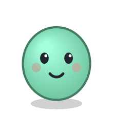
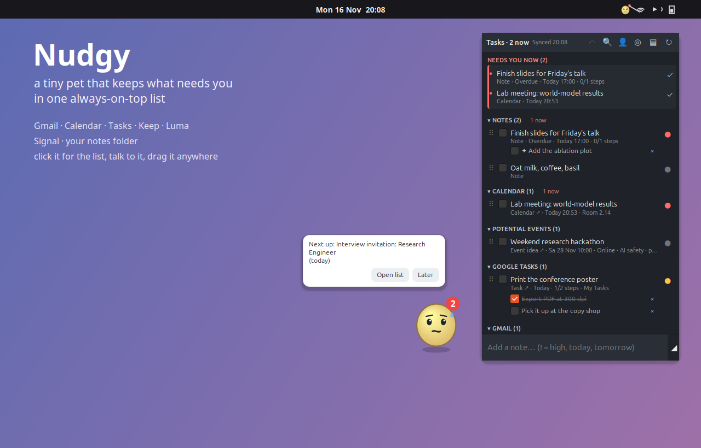
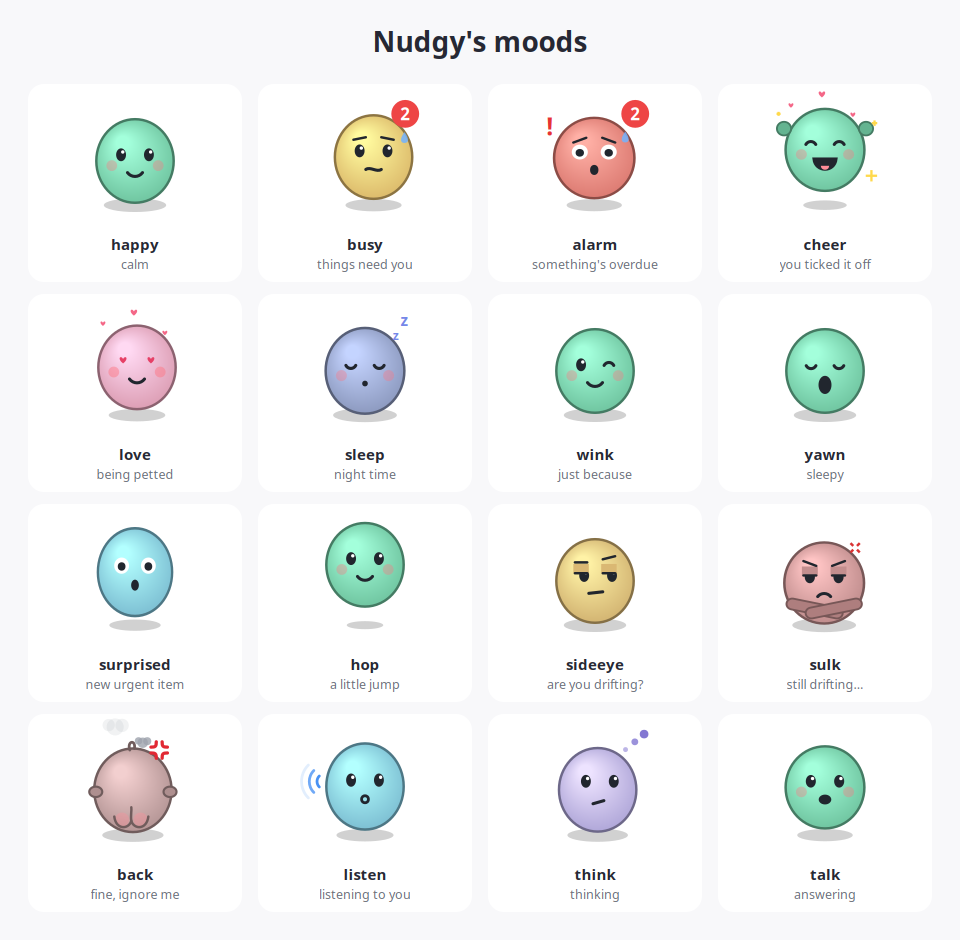
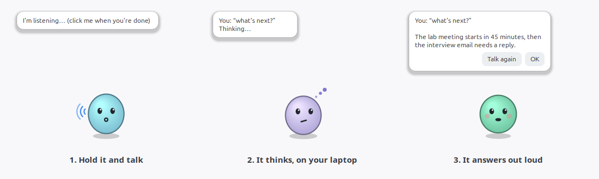
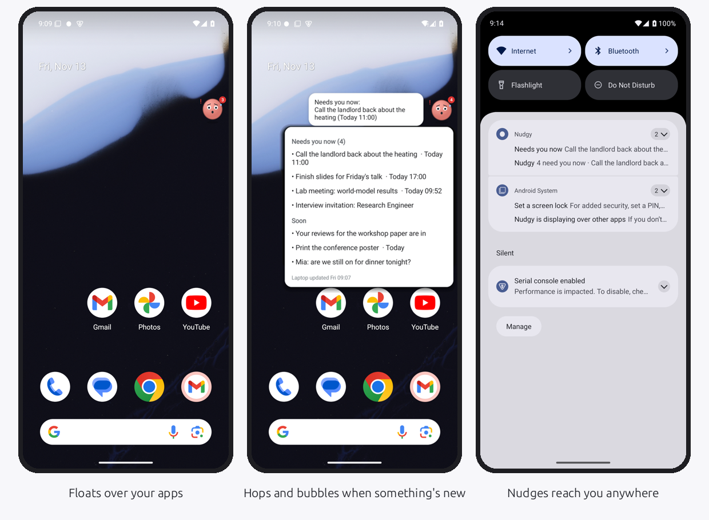

# Nudgy

A tiny round pet that sits on your desktop, keeps everything that needs you in one always-on-top list,
and gets visibly worried when things pile up. Click it for the list, talk to it, drag it anywhere, or hide
it in the top bar. It starts at login and restarts itself if it crashes.

It's calm when nothing is pressing, busy with a badge when things need you, alarmed when something's
overdue, cheers when you tick something off, loves being petted (wiggle the pointer over it), sleeps at
night, and gives you a side-eye, then a sulk, then its back if the optional focus check catches you drifting.

*All pictures are made from a demo with made-up tasks by `tools/screenshots.py`.*

| Source | What appears |
| --- | --- |
| Notes | Anything you type into the box at the bottom |
| Google Calendar | Your visible calendars for the next 7 days (leave some out with `skip_calendars`, below) |
| Google Tasks | All open tasks, including Google Keep **reminders** |
| Gmail | Unread inbox mail from the last 14 days marked important or starred |
| LinkedIn | Unread LinkedIn message, invitation and job emails in Gmail |
| Signal | Unread messages, one line per chat, until you read them on any device or reply |
| Notes folder | Unticked `- [ ]` items from Markdown checklists in a folder you choose (such as Claude Code session notes); off until set |
| Luma | Events you host, registered for, are waitlisted or invited to, next 14 days |
| Potential events | Public events across Europe (your home city first) that fit your interests, best first |

Click **👤** in the top bar to sign in to Google and link Signal. Every service is
read-only: Nudgy cannot change or send anything, and sends no read receipts. Ticking off a Google item only
hides it on this laptop. Every minute Nudgy asks each source whether anything new arrived (Gmail, Tasks, Calendar,
your notes folder; Signal every 2 minutes) and fetches only those right away; everything is
fetched in full once an hour. ↻ fetches everything now. Once an hour, or right after ↻, the local model turns
new long jotted notes (Keep notes in Google Tasks, your own notes) into 2–5 concrete ✦ steps under
them; remove any with ×. This is **off by default**; turn it on with `"digest": {"enabled": true}` in
[settings](#settings) (needs [Ollama](https://ollama.com); see [Local models](#local-models-and-optional-claude)).

**Limits.** Keep notes without a reminder do not appear, because Google offers no Keep API for
personal accounts. LinkedIn items appear only if LinkedIn emails you about them.

## Install

Needs a Linux desktop with systemd, Python 3.10+ and GTK 3 for Python. On Ubuntu or Debian:

    sudo apt install python3-gi python3-gi-cairo gir1.2-gtk-3.0 gir1.2-ayatanaappindicator3-0.1
    git clone https://github.com/msverma101/nudgy.git ~/nudgy
    cd ~/nudgy && ./install.sh

The installer checks what's missing, never uses sudo and only writes inside your home folder. It installs the
`nudgy` package with [pipx](https://pipx.pypa.io) if you have it (`sudo apt install pipx`), otherwise into a
private environment in `~/.local/share/nudgy/app` (needs `python3-venv`). Options:
`--no-shortcut` (no Super+T / Super+Shift+T),
`--no-start`, and `--editable` (for working on the code: changes in the folder apply without reinstalling).
After `git pull`, run `./install.sh` again. `nudgy --version` shows what you have.

Without the installer: `pipx install --system-site-packages .` gives you the `nudgy` command (the system
GTK packages above are still needed; Nudgy has no other dependencies).
Then connect the accounts you want (below). Each is optional.

To remove it: `./uninstall.sh` (keeps your settings and sign-ins) or `./uninstall.sh --purge` (deletes them too).

## Privacy and security

- **No telemetry, no Nudgy server.** Nudgy never reports anything about you or how you use it. It talks
  only to the services you connect (Google, Luma, Signal, public event feeds you enable), to
  Ollama on your own computer, and **only if you connect Claude**, to Anthropic (with your own API key or
  Claude Code login). Without that, no text ever goes to an AI service. When it runs `claude` it switches
  off Claude Code's usage statistics, error reports and update checks, so only the request itself is sent.
- **Your data stays on your computer**, in `~/.config/nudgy` and `~/.local/share/nudgy`; only your user
  can read them (folders 700, files 600). Sign-in tokens are stored there too.
- **Read-only by default.** It never sends, deletes or marks anything read on Google or Signal.
  Adding to Google Calendar/Tasks by voice needs a separate permission you grant on first use; the
  read-only sign-in is never widened. Reply drafts open for you to edit and send: Nudgy never sends.
- **Your own Google app.** You create the Google sign-in client yourself (below), so no one else's app
  gets access to your mail. Revoke it any time at <https://myaccount.google.com/permissions>.
- **Talking is local.** Speech is transcribed, answered and spoken on your laptop by open models
  (Whisper, Qwen3 through Ollama, Piper). After `nudgy voice setup` downloads them, the speech parts run
  offline. Recordings are deleted right after transcription; the microphone is only on while the pet shows
  its listening face.
- **Protected against prompt injection.** Your list contains text other people wrote (email subjects,
  messages, event listings). Nudgy treats it as data:
  - the local model's choices only count when *your own words* asked for that kind of change and named
    the item; adding to Google only happens from what you said, never from the model;
  - the models that write drafts and steps (local, or Claude if you connected it) get no tools, plugins
    or settings, so text they read can't make them run anything; message text is passed as text to
    answer, not instructions;
  - links from outside open only if they're `https://`; links that open things on your computer
    (`file://`, `obsidian://`, resuming a Claude session) work only for your own notes.
- **AI features are off until you turn them on**: the focus check, note steps and talking all use a local
  model; Claude is used only if you connect it, and only for the jobs you allow.
- **Pinned downloads.** The voice packages are installed at exact versions, and Ollama verifies its
  models by checksum.
- **No unofficial access.** Every source uses an official API, a feed or link the service offers, or
  your own files. (WhatsApp support was removed: it needed an unofficial library that breaks WhatsApp's
  terms and can get a number banned. Upgrading removes the old bridge and its data.)

## Using it

- **The pet.** Nudgy lives as a small round face you can drag anywhere. Click it to open or close
  the list; the list also closes by itself after 8 seconds unused (Esc closes it at once). Its face
  and movement follow your list: mint and bobbing (hopping, winking, yawning, looking around) when
  nothing needs you now; yellow, worried and pacing with a count when things do; coral, wide-eyed and
  bouncing with a "!" when something is overdue; asleep at night; arms up and sparkles when you tick
  something off. Its eyes follow the pointer, and wiggling the pointer over it pets it (hearts).
  Middle-click, or every 30 min when busy (15 when overdue), it says what's next in a bubble.
  Right-click for What's next, Sync, Accounts, the focus check and Hide.
- **Needs you now.** Urgent items sit at the top of the list as a red bulleted block, written out
  (up to 4 lines; hover for the full text). Click a bullet to open it, ✓ to finish it. Hovering the
  pet, or clicking the top-bar icon, lists the same items as bullets.
- **Search.** 🔍 in the top bar, or Ctrl+F. It looks through everything, including what Important
  only hides: titles, details (like the sender or list), the source name ("gmail", "signal") and steps.
  Every word must match, in any order and any case. Esc closes the search; Esc again closes the list.
- **Steps from other items.** Drag an item (⠿) onto the middle of another to make it a step there
  (top or bottom edge of a row still just reorders), or right-click > Make a step of…. The step keeps
  the item's link, so clicking it still opens the email or page. Right-click a step > Make it a
  separate item to take it back out. Ctrl+Z undoes either.
- **Focus check (off by default; right-click the pet to turn it on).** Every 3 minutes the pet reads the title of the window in front (no screenshots,
  no keys) and, when something is urgent and you've stayed on one window, judges whether it helps:
  rules first (task words in the title, work apps), then the local model (which may look up one
  unfamiliar term on Wikipedia), and only if that is unsure and you [connected Claude](#local-models-and-optional-claude),
  Claude (at most 20 times a day, about 1,000 tokens each). If you're drifting it
  side-eyes and asks, then sulks after 10 minutes, then walks to the middle of the screen and turns
  its back after 15 more (5 and 8 when something is overdue). "Yes, it is" trusts that window for an
  hour. Nothing urgent means no judging. Settings: the `focus` section of [settings](#settings) (work apps,
  distractions, your work topics, model, Claude cap). `nudgy focus` shows today's summary;
  `nudgy focus test "<title>"` shows how a title would be judged; the log stays local in
  `~/.local/share/nudgy/focus-log.jsonl`.
- **Hiding.** Right-click > Hide, or **Super+T**, tucks it into the top bar next to the Wi-Fi icon
  (the same face, smaller). Press Super+T again, or click the top-bar icon > Show the pet. The
  shortcut runs `nudgy toggle`; change it in Settings > Keyboard > Custom Shortcuts.
- **Important only (◎, on by default).** Shows only what needs attention today: events within
  2 hours or happening now, anything due today or overdue, starred mail, mail or chats with words
  like urgent or deadline (your own list: `ranking.urgent_words`), anything you set to high, and your own notes. Everything else
  waits behind **+ N less urgent · show all** (or ◉ in the top bar) and comes back by itself as its
  date gets close. `nudgy list --all` prints everything.
- Type a note and press Enter. `!` at the start or end means high priority; ending with `today` or
  `tomorrow` sets the date: `!pay rent tomorrow`
- Click an item to open it. Double-click a note to edit it. Right-click for more.
- Click the coloured dot to cycle priority: high, low, automatic.
- Items are grouped by where they come from (Notes, Calendar, Luma, Gmail, Signal…), most pressing
  first inside each group. Click a group's heading to fold it. **▤** switches to Now / Soon / Later.
- Click an item to open it where it came from: the email in Gmail, the event in Google Calendar or
  Luma, or the chat in Signal Desktop. **↗** marks items that open something.
  Right-click a note > **Link to an email or page…** to give it a link too.
- **Claude sessions** shows what earlier Claude Code sessions left open, by project. Real deadlines in
  the text ("Sun 22 Nov", "21–22 Nov") set the date, and URGENT puts an item in Now. Ticking one
  ticks it in the notes file too (Ctrl+Z unticks it). Clicking opens its link, or the notes file
  (in Obsidian once that folder is a vault). "Resume: …" items open a terminal that resumes that
  session.
- Drag an item by its **⠿** handle to put it where you want inside its group, or right-click >
  **Move to top / up / down / bottom**. Items you placed keep their spot; new items still slot in by
  urgency. Right-click > **Back to automatic position** undoes a placement. In the Now / Soon / Later
  view, dragging an item into another section also sets its priority (Now = high, Soon = medium,
  Later = low).
- Tick an item when finished.
- **Ctrl+Z** undoes any change (ticking, adding, editing, priority, steps), however long ago, and
  **Ctrl+Shift+Z** redoes it. An Undo button also shows for 10 seconds after each change.
- Public holiday and birthday calendars are skipped.
- Right-click any item, even a Gmail or Calendar one, and choose **Add steps…** to break it into
  smaller steps. Press Enter after each step. Steps appear under the item with their own tick boxes.
  Double-click a step to edit it, or click × to remove it. **Clear finished steps** in the right-click
  menu tidies up. Steps are kept on this laptop only and are never sent to Google.
- Drag the top bar to move, the ◢ corner to resize. ▾ collapses it to one line.

## Priority

**Now:** events in progress or within 2 hours, overdue items, anything you set to high, and mail
containing urgent words (`ranking.urgent_words`, e.g. urgent, deadline). **Soon:** due today or tomorrow, important or
starred mail, LinkedIn messages. **Later:** everything else.

## Potential events

This is **off by default**. To turn it on, put a `discover` section in [settings](#settings): start from
`examples/discover.json` (a few Luma city pages and dev.events) or `examples/discover-ml-ai.json` (the same
plus ML and AI-safety interests), set `"enabled": true` and `"home"` to your city, and
add the Luma calendars (`"cal-…": "name"`, from a calendar's Subscribe link), Meetup groups and RSS feeds
you follow. Nudgy then searches
public event listings every 6 hours (`nudgy events` searches now) and keeps
the 30 that fit best over the next 5 months. Only public sources meant to be read are used, with no
logins: Luma calendar subscriptions, Luma's city pages, Meetup group calendars, RSS feeds such as
dev.events, and a watchlist of events you add by hand from official websites.
LinkedIn and Eventbrite are left out because they offer no public way to search events.

Each event gets a fit score out of 100: hackathons, conferences and hiring events score highest,
plus AI safety and ML topics, big-name companies, prize money, and closeness to your home city (set
`"home": "Hamburg"` or similar; then the rest of Germany, then Europe, then online). Social events are pushed down. Events you already registered,
applied or are waitlisted for are left out (from your Luma link and Luma's emails, subjects only).
Important only shows the best 6; tick one to hide it ("not interested").

Change the sources, `topics` you care about (each with words and points), `big_names`, organiser weights
or watchlist in the same section. With no topics, events are ranked by kind, prizes and distance only.

## Talking to Nudgy

**Hold the pet** with the left mouse button for half a second (or press **Super+Shift+T**) and just talk.
It stops listening when you pause (or click it) and answers out loud. If you're wearing Bluetooth headphones
with a mic, it listens through them (switching them to headset mode just while it listens, like a call).
Click it while it talks to stop it. It understands English and German.

| Ask | For example |
| --- | --- |
| What's on the list | "top 5", "what's next", "what do I have today / tomorrow / this week", "what's overdue", "summarise my day" |
| Find things | "find the email about the interview", "anything about Luma?", "what did Mia say?", "any Signal messages?" |
| About one item | "when is the dentist?", "where's the lab meeting?", "who sent the reviews email?" |
| Add | "remind me to call the bank tomorrow at 10", "add milk", "in an hour: stretch" |
| Change | "I finished the poster", "move the dentist to Monday", "remind me about the slides in an hour", "make the slides urgent", "add a step to the poster: laminate it" |
| Undo | "undo that" (or the Undo button in the bubble) |
| Focus | "focus on the slides for 25 minutes" (a ring around the pet counts down), "stop the timer", "turn the focus check off" |
| Controls | "sync now", "open the interview email", "show me the list", "hide" |
| Write | "break the slides into steps", "draft a reply to the interview email saying Tuesday works", "write back to Mia that I'm running late" |
| Google* | "add call the dentist on Friday to my Google Tasks", "put lunch with Mia tomorrow at 1pm in my calendar" |

Questions about the list are answered straight from it, so they're instant and exact; the local model is only
used to work out what you want done and to chat. Moving a Google item only hides it here until then (Nudgy
reads Google; it doesn't change it), while your own notes really move.

**Writing** (drafts, steps) uses the local model, or Claude if you connected it; it gets the item's title (and
the email's text, for a draft). Drafts open in a window you edit; "Open in Gmail" fills in a reply for you
to send: Nudgy never sends anything.
**Google**: the first time you ask, Nudgy asks for permission to add to your Calendar and Tasks, in a separate
sign-in, so your read-only one stays read-only. Everything it adds has an Undo button.

Everything runs on your laptop with free, open-source models; nothing is sent anywhere:

| Step | Model | Licence | On a mid-range laptop |
| --- | --- | --- | --- |
| Hear | [faster-whisper](https://github.com/SYSTRAN/faster-whisper) `base` (CPU, int8) | MIT | ~1.5 s for a sentence |
| Think | [Qwen3.5](https://ollama.com/library/qwen3.5) (size picked for your computer) through [Ollama](https://ollama.com) | Apache 2.0 | ~5 s with 4B on a 4 GB GPU |
| Speak | [Piper](https://github.com/rhasspy/piper) voices | MIT | ~0.1 s |

Set it up once (about 3.5 GB of downloads, into `~/.local/share/nudgy/voice`). You need
[Ollama](https://ollama.com) for the thinking part, and `sudo apt install python3-venv` unless you have
[uv](https://docs.astral.sh/uv/):

    nudgy voice setup        # speech libraries in their own folder, Whisper, two voices, the local model
    nudgy voice test         # say one sentence and see how long each step takes
    nudgy voice ask "what's next?"   # try the thinking part by typing

The models load while you're still talking and are let go after a few quiet minutes. Change models or
voices in the `voice` section of [settings](#settings) (for example `"microphone": "laptop"` to never use a
headset mic, or `"whisper": "small"`, which hears better but is slower). Audio is never saved: each recording goes to a private
temporary file that's deleted right after it's transcribed.

## Local models and optional Claude

Everything that needs a language model runs **on your computer** through [Ollama](https://ollama.com):
understanding what you say, reply drafts, breaking notes into steps and the focus check. Nudgy picks the
best model your computer can run from a small tested list (`nudgy models` shows it):

| Your computer | Model |
| --- | --- |
| 8 GB graphics card or more | Qwen3.5 9B |
| 4 GB graphics card | Qwen3.5 4B |
| no graphics card | Qwen3.5 2B (0.8B on very small machines) |

`nudgy models use NAME` picks another one (for example `gemma4:e4b`, which writes slightly better drafts
but is slower), `nudgy models use auto` goes back. How the models compare on Nudgy's own tasks:
[docs/models.md](docs/models.md).

**Claude is optional.** `nudgy claude connect` (or Accounts > Claude) lets Claude do the writing jobs:
drafts, steps and the focus check's unsure cases (choose which with `ai.claude_for`). Use an API key from
the [Anthropic Console](https://console.anthropic.com/settings/keys) (Nudgy then installs Anthropic's Python
library, its only optional dependency) or your Claude Code login. Only the text of that one job is sent;
talking to the pet always stays on your computer. `nudgy claude disconnect` goes back to local only. The
default Claude model is `claude-haiku-5-5` (about $0.10 / $0.50 per million tokens in and out, a fraction of
a cent per draft); set `ai.claude_model` to `claude-opus-5-5` for better writing at about 40× the price.

## Nudgy on your Android phone

`android/` holds a small Android app (Android 8+, no extra libraries, no internet permission): the same round
pet floating over your other apps, like a tamagotchi in your pocket. Tap it for what needs you now and soon;
drag it anywhere and it snaps to the side. When something new needs you it hops, shows a bubble and sends
a notification, so the nudge reaches you even with the screen off. Overdue things get a gentle reminder
every two hours during the day (8:00–22:00). A Quick Settings tile shows or hides the pet.

The laptop stays the brain. The phone only reads one file that the laptop keeps up to date:

1. Share a folder between laptop and phone, for example with Syncthing (laptop and phone apps).
2. On the laptop: `nudgy phone ~/Sync/nudgy`. Nudgy writes `nudgy-now.json` there after each update
   (titles, due times and web links of your top items; nothing else).
3. Build and install the app: `cd android && ./gradlew assembleDebug`, then install
   `app/build/outputs/apk/debug/app-debug.apk` (copy it to the phone, or `adb install` it).
4. In the app: pick the shared folder, allow "display over other apps", set battery use to unrestricted
   (Vivo, Xiaomi and others stop background apps otherwise), then Show Nudgy.

If the laptop hasn't written for 3 hours, the pet falls asleep and the list says it may be out of date.

## Connecting Luma

Luma's API is only for hosts on a paid plan, so Nudgy reads your personal calendar link instead.
On luma.com go to Settings > Calendar Syncing (under Third Party Accounts) > Add iCal Subscription,
copy the link, then click 👤 > Luma > **Connect…** and paste it (or run `nudgy luma LINK`). Keep the
link private. Events that are already in your Google Calendar are not shown twice.

## Connecting Signal

Nudgy uses [signal-cli](https://github.com/AsamK/signal-cli), linked to your phone as an extra
device like Signal Desktop. Install its standalone Linux build from its releases page and put the
`signal-cli` command on your PATH (for example in `~/.local/bin`). Click 👤 > Signal > **Link…** and scan the code with Signal >
Settings > Linked devices > Link new device (or run `nudgy link signal` in a terminal).

New messages are fetched at every sync. A message leaves the list when you read it on your phone or
Signal Desktop, or when you reply. To unlink, remove "Nudgy" under Linked devices on your phone.
Signal drops linked devices that are offline for 30 days.

## Connecting Google (once, about 10 minutes)

1. At <https://console.cloud.google.com> create a project.
2. Under *APIs & Services > Library*, enable **Google Calendar API**, **Google Tasks API** and
   **Gmail API**.
3. Under *Google Auth Platform*, set the audience to **External** and add your Gmail address as a
   test user.
4. Under *Audience*, choose **Publish app**. Otherwise Google ends your sign-in every 7 days.
5. Under *Clients*, create a **Desktop app** client and download its JSON to
   `~/.config/nudgy/google-client.json`.
6. Click 👤 > Google > **Set up…** and choose the JSON file, or run `nudgy auth`. Google will warn that the app is unverified: it is your own app, so choose
   *Advanced*, then continue.
7. Run `nudgy sync` to check each source.

To leave calendars out (for example one that only holds alarms), list their names in
[settings](#settings): `"google": {"skip_calendars": ["Alarms"]}`.

## Settings

All preferences live in one file, `~/.config/nudgy/settings.json`, which only holds what you changed;
everything else uses the defaults in [`nudgy/settings.py`](nudgy/settings.py) (the full list, with comments).
A value of the wrong type is ignored with a warning in the log, so a typo never breaks a feature. Sign-ins
are not settings: they stay in their own private files. Sections:

| Section | What it holds |
| --- | --- |
| `ranking` | `urgent_words` (make mail and chats urgent), `calendar_days`, `mail_days`, `events_days` |
| `google` | `skip_calendars`: calendar names to leave out |
| `claude_notes` | `folder` with Markdown checklists (off while empty), `files` (empty: every `.md` in it) |
| `ai` | `local_model` (empty: best for this computer), `claude` (not connected unless you connect it), `claude_model`, `claude_for` |
| `focus` | the focus check: on/off, interval, work apps, distractions, Claude cap, `work_topics` |
| `voice` | talking: on/off, Whisper size, voices, microphone |
| `digest` | turning long notes into steps: on/off |
| `discover` | the event finder: on/off, `home`, `near_km`, sources, `topics`, `big_names`, watchlist |
| `phone` | `folder` shared with the Android app |

For example, to read your Claude Code notes and treat interview mail as urgent:

    {
     "claude_notes": {"folder": "~/Documents/Notes"},
     "ranking": {"urgent_words": ["urgent", "asap", "deadline", "interview", "job offer"]}
    }

In a notes folder, a file with "deadline" in its name (like `Deadlines.md`) holds hard deadlines: its
dated items stay overdue instead of being treated as notes about the past. Older versions kept one file
per feature (`focus.json`, `voice.json`, …); they are moved into `settings.json` the first time a new
version runs, and the old files are kept as `*.json.migrated`.

## Commands

    nudgy auth                          # sign in to Google
    nudgy sync                          # fetch now and report each source
    nudgy accounts                      # which services are connected
    nudgy link signal                   # link Signal by QR code in the terminal
    nudgy luma LINK | off               # connect or disconnect Luma
    nudgy list                          # print the list in the terminal
    nudgy talk                          # talk to the pet (Super+Shift+T)
    nudgy models [use NAME | use auto]  # the local model for this computer
    nudgy claude connect | disconnect | status   # optional Claude
    nudgy voice setup | on | off | test | ask TEXT
    nudgy phone FOLDER | off            # share the list with the Android app through FOLDER
    systemctl --user stop nudgy         # close until next login
    systemctl --user disable --now nudgy    # stop starting at login

Always-on-top needs an X11 session. On Wayland GNOME ignores it.

Your data is in `~/.local/share/nudgy/state.json`, your Google token in `~/.config/nudgy/token.json`.

If something doesn't work, the log says what failed: `journalctl --user -u nudgy`.

Tests: `python3 -m unittest discover -s tests -t .` Checks used in CI: `uvx ruff check nudgy tests tools`,
`uvx mypy nudgy`, and for the Android app `cd android && ./gradlew testDebugUnitTest assembleDebug`.

## Licence

MIT, see `LICENSE`.
